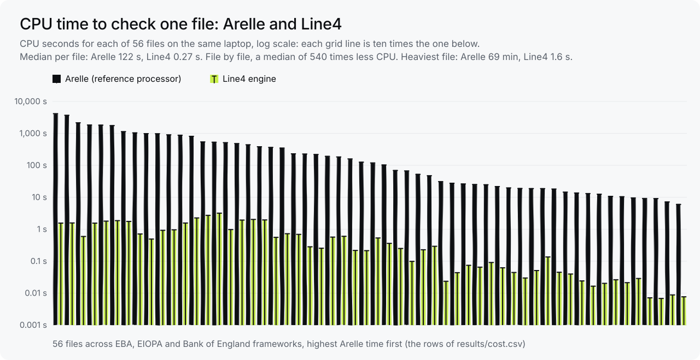
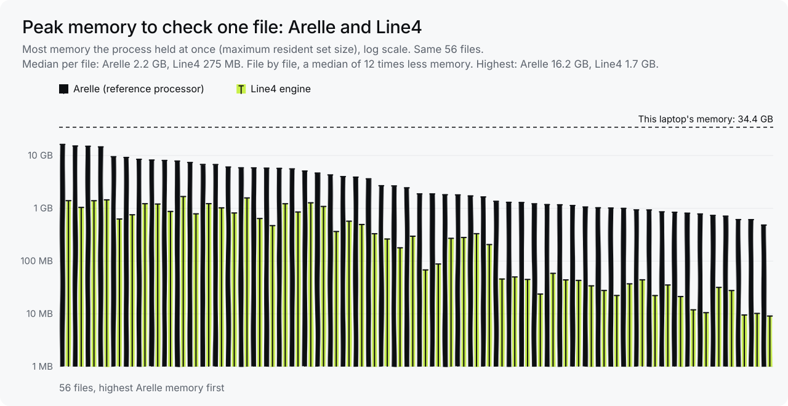
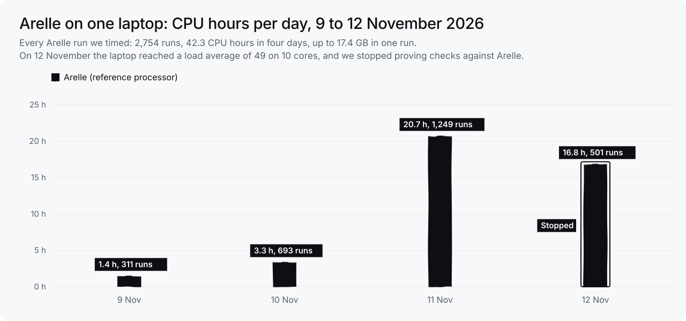

# Line4 XBRL validation benchmark

Results of benchmarking the Line4 XBRL validation engine against [Arelle](https://arelle.org), the widely used open-source reference processor, on about 290 sample filings across recent EBA, EIOPA and ESEF releases (November 2026).

Full write-up, including the caveats: https://www.line4.ai/blog/xbrl-validation-engine-benchmark

## Headline results

| Measure | Result |
| --- | --- |
| Agreement with Arelle, formula assertions | 99.95% (417,342 of 417,531) |
| Agreement on EBA reporting frameworks 4.0 to 4.3 | 100% (330,046 assertions, plus instance, DTS and validation-code checks) |
| One large FINREP filing, controlled conditions | 16 seconds, against 4.2 hours for Arelle |
| CPU and memory per file, 56 files on the same laptop | A median of 540 times less CPU and 12 times less memory than Arelle |

## By release

| Release | Agreement | Detail |
| --- | --- | --- |
| EBA 4.0, 4.1, 4.2, 4.3 | 100% | 330,046 assertions, plus every instance, DTS and validation-code comparison |
| EIOPA Solvency II, pension funds, IRRD, FICOD | 99.84% | 86,824 of 86,960 assertions |
| ESEF | 98.1% | 472 of 481 assertions, plus a few document and context differences |

## Data

- `results/agreement-by-release.csv`: agreement with the reference processor, by release family
- `results/speed.csv`: validation times, with conditions and caveats
- `results/cost.csv`: CPU and peak memory per file, Arelle and the Line4 engine, 56 files
- `results/arelle-runs-by-day.csv`: every Arelle run we timed on one laptop, 9 to 12 November 2026, by day
- `results/charts/`: the charts below, as SVG and PNG

## Method

- About 290 sample filings across every release the engine supports.
- For each filing, every formula assertion result was compared with Arelle's. For the EBA releases, every instance, DTS and validation-code outcome was compared as well.
- Each run makes the engine better: every disagreement is investigated, what we learn goes into the next iteration with a test to lock it in, and where the reference engine is the one that differs, we write it up.

## The disagreements

About 190 assertions disagree, from a handful of causes repeated across filings:

- One EIOPA Solvency II assertion disagrees in all three releases.
- A few other EIOPA assertions produce different counts.
- Around a dozen agree on the counts but bind different facts. That can be a real difference or a difference in how facts are keyed.
- ESEF shows a few classification and context-count differences.

## Speed, with the caveats

On one large FINREP filing, measured under controlled conditions, the Line4 engine took 16 seconds against Arelle's 4.2 hours. Across the full set, a first run suggests around 160 times faster: Arelle's recorded time adds up to 35.8 hours of CPU, against 13.5 minutes for the Line4 engine. Treat that wider figure as rough. Both ran on a heavily loaded machine and Arelle is single-threaded. A controlled head-to-head is still to come, and we will publish it here.

## Cost: CPU and memory

Speed is one cost. The CPU and memory a check needs are the others: they decide the hardware a supervisor needs and how many returns it can check at once.

On 12 November 2026 we stopped proving our checks against Arelle on a laptop. That day Arelle used 16.8 hours of CPU in 501 runs, single runs held up to 12.6 GB of memory, and the laptop (10 cores) reached a load average of 49.

We then ran the Line4 engine on 56 of the files Arelle had checked, one at a time, on the same laptop:

| Per file, 56 files | Arelle | Line4 engine |
| --- | --- | --- |
| CPU, median | 122 seconds | 0.27 seconds |
| CPU, highest | 69 minutes | 3.2 seconds |
| Peak memory, median | 2.2 GB | 0.27 GB |
| Peak memory, highest | 16.2 GB | 1.7 GB |
| CPU, all 56 files together | 7.7 hours | 37 seconds |

Compared file by file, the Line4 engine used a median of 540 times less CPU and 12 times less memory than Arelle. Across the 56 files it used 138 to 3,614 times less CPU and 3.7 to 74 times less memory.

Every Arelle run we timed on that laptop, 9 to 12 November 2026:

| Day | Runs | CPU hours | Highest peak memory | Runs over 4 GB |
| --- | --- | --- | --- | --- |
| 9 November | 311 | 1.4 | 3.8 GB | 0 |
| 10 November | 693 | 3.3 | 5.2 GB | 4 |
| 11 November | 1,249 | 20.7 | 17.4 GB | 118 |
| 12 November | 501 | 16.8 | 12.6 GB | 41 |
| All four days | 2,754 | 42.3 | 17.4 GB | 163 |

### How we measured

- **Machine.** One laptop: Apple M5, 10 cores, 32 GiB of memory, macOS 26.2. Both engines ran on it.
- **Arelle.** Version 2.47.4, offline from the published taxonomy packages, running the formula assertions of the file's module and writing out each assertion's result counts. Each run wrote a timing record (`/usr/bin/time -l`) beside its log. We read CPU (user plus system time), wall time and peak memory (maximum resident set size) from those records. A record copied to two places counts once: 2,754 runs. 17 empty records are left out, so the totals are if anything low. For the 56 files we matched each record to its input file through the log and the file's contents. On 50 of them Arelle also ran XBRL 2.1 and dimensional validation; six of the seven EBA 4.x files ran the formulas only (marked in `cost.csv`).
- **The 56 files.** Nine taxonomy releases: EBA 3.0 as UK firms file it, EBA 4.0, 4.1 and 4.2, EIOPA Solvency II 2.8.2 and 2.10.0, and the Bank of England's Solvency UK 2.2.0, banking 4.1.1 and statistics 1.3.1. They include the heaviest files Arelle ran and smaller ones: published samples, synthetic files with every datapoint filled, and a few control files (a sample with some values changed). Each file is unchanged since Arelle ran it. Where Arelle ran a file more than once, we take the complete run that evaluated the most assertions and, of those, the fastest.
- **Line4 engine.** The command line build of the Line4 engine (Rust), on one thread, writing its full result: every error and warning with its message. Two passes over the 56 files, one file at a time; in each pass, one run to warm up, then 5 timed runs (3 for files that take 2 seconds or more). We report the median of all the timed runs, 6 to 10 per file. Each run ran under `/usr/bin/time -l`, with CPU taken from the operating system's own accounting of the process, to the microsecond. The second pass waited for the laptop to be quiet before each file; the two passes differ by a median of 3% per file.
- GB means 10^9 bytes.

### Caveats

- **Not the same work.** Arelle loads the whole taxonomy and, on most files here, also checks XBRL 2.1 and dimensions. The Line4 engine runs checks compiled ahead of time from the same taxonomy, plus filing rules, and runs a rule only when the file reports its templates. Compiling the checks happens once per taxonomy release and is not counted here. How closely the results agree is in the sections above.
- **Arelle was not measured under controlled conditions.** Its numbers come from our proving runs, and many of them shared the laptop with other heavy jobs. CPU time and peak memory are counted per process, so they hold up under load far better than wall time, which is why we compare CPU and memory, not wall time: on 12 November Arelle's wall time added up to 59.6 hours for 16.8 hours of CPU. A controlled run of both engines side by side is still to come.
- **The choices favour Arelle.** Where Arelle ran a file more than once we take its fastest complete run, and runs stopped before they finished are left out of the per-file figures (three of the files had one, of up to 997 CPU seconds). On one control file Arelle evaluated only the 78 assertions the control targets, while the Line4 engine ran all 1,361 rules of the module.
- **Peak memory is resident memory.** When memory runs short, macOS compresses memory or swaps it out, so a resident peak can understate what a process asked for. For the same Arelle runs, macOS's own "peak memory footprint" went up to 28.2 GB. We use the lower figure.
- **The smallest files.** On the smallest files the Line4 engine takes a few milliseconds, most of it starting the process and loading the checks.
- **Not in the sample.** EBA files in xBRL-CSV (their Arelle logs name unpacked temporary copies we can no longer match to a file) and EBA's COREP own funds module (Arelle ran it in batches of rules).
- **One laptop.** The two engines may compare differently on a server.

## Questions to ask any XBRL validation engine

1. How closely does it agree with a reference implementation, release by release, and where does it differ?
2. Who investigates each disagreement, and how quickly is it fixed or explained?
3. How long does it take to validate your largest return, measured under controlled conditions?
4. How long would it take to re-validate a year of filings after a rule change?
5. Can your team change and version the rules, or does every change wait for a release?
6. How much CPU and memory does it need for your largest return, and how many returns can one machine check at once?

## About Line4

[Line4](https://www.line4.ai) builds modern SupTech for financial regulators: regulatory data collection, validation, AI review of returns and casework, deployed by engineers inside the regulator's team.

Figures are from Line4's internal benchmark, November 2026. Arelle is an open-source XBRL processor; we used it as the reference because it is widely used and freely available for anyone to check our numbers.

## Licence and citation

Results and text: CC BY 4.0 (see `LICENSE`). Citation details: `CITATION.cff`.
